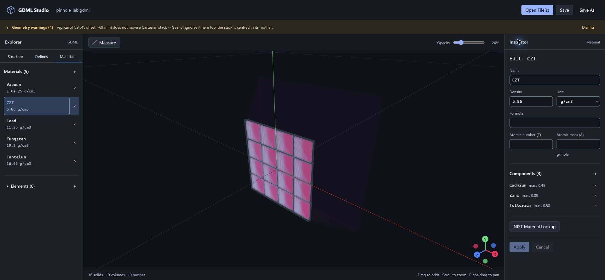

# GDML Studio

> **Early-stage project** — This is a fresh prototype under active development. It likely does not fully work yet. Expect rough edges, missing features, and bugs. Contributions and bug reports are welcome.

A lightweight desktop tool for viewing [GDML](https://gdml.web.cern.ch/GDML/) (Geometry Description Markup Language) detector geometry files. GDML is the standard geometry format used by [Geant4](https://geant4.web.cern.ch/) and other particle-physics simulation frameworks. GDML Studio lets you quickly inspect these geometries without launching a full Geant4 session — it parses the GDML XML, evaluates expressions and units, tessellates solids into triangle meshes, and renders the 3D scene in a desktop window (or a browser).

<p align="center">
  
</p>

## Architecture

| Layer | Tech | Path |
|-------|------|------|
| Backend | Rust / Axum | `backend/` |
| Frontend | React / Three.js (via React Three Fiber) | `frontend/` |
| Desktop shell | Electron | `desktop/` |

The backend exposes a REST API that the frontend consumes. Communication is JSON over HTTP.
The desktop app starts the backend on a free local port; the backend also serves the
built frontend, which the app shows in its window.

## Desktop app

Both packages bundle everything: Rust, Node.js and a browser are not needed.

**Windows:** run `GDML Studio Setup 0.1.0.exe`. It installs per user (no admin rights).
The installer is not code-signed, so Windows SmartScreen may warn on first run
(**More info → Run anyway**).

**Ubuntu 20.04 or newer:** `sudo apt install ./gdml-studio_0.1.0_amd64.deb`, then start
**GDML Studio** from the applications menu or run `gdml-studio`. Tested by installing and
launching on clean Ubuntu 20.04 and 24.04.

To build the packages (needs the [prerequisites](#prerequisites)):

```bash
cd desktop
npm install
npm run dist         # on Windows: desktop/dist/GDML Studio Setup 0.1.0.exe
npm run dist:linux   # on Linux or WSL: desktop/dist/gdml-studio_0.1.0_amd64.deb
```

`dist:linux` also needs `rustup target add x86_64-unknown-linux-musl`. The Linux backend is
a static musl binary, so it runs regardless of the system's glibc version. The cost is
about 1.4× slower loading than a glibc build (213 vs 150 ms for
`pod_asm_tessellated.gdml`). If that ever matters, switch the global allocator, e.g. to mimalloc.
When building in WSL, work on a copy inside the Linux filesystem (not `/mnt/c`), since
the Windows `node_modules` cannot be reused.

Where the GPU is unavailable or blocklisted (VMs, remote desktops, WSL), the 3D view
falls back to software rendering.

`npm start` runs the desktop app from the repo after `npm run build:backend` and
`npm run build:frontend`. Set `GDML_PORT` (e.g. `GDML_PORT=4001 npm start`) to pin the
backend's port, so the same session can also be opened in a browser for debugging.

## Prerequisites

- **Rust** stable toolchain — [install via rustup](https://rustup.rs/)
- **Node.js** v20.19+ or v22.12+, and **npm** — [install from nodejs.org](https://nodejs.org/)
  (required by Vite 7; on Node 18 `npm install` only warns and the dev server then fails)

## Quick Start

### 1. Clone the repository

```bash
git clone git@github.com:davsar89/GDML_Studio.git
cd GDML_Studio
```

### 2. One-command start (recommended)

Scripts that build the backend, run tests, start both servers, and open the browser.
This browser mode, with Vite hot reload, is the development and debugging setup.
The scripts check for prerequisites first and will tell you exactly what to install if anything is missing.

```bash
# Linux / macOS
./run.sh

# Windows
run.bat
```

### 3. Manual start

**Backend** (terminal 1):

```bash
cd backend
cargo run --release
```

The backend compiles and starts an HTTP server on `http://127.0.0.1:4001`.
On the first run, Cargo will download and compile all dependencies (this may take a minute or two).

**Frontend** (terminal 2):

```bash
cd frontend
npm install      # only needed on first run
npm run dev
```

Vite will print a local URL (typically `http://localhost:5173`).

### 4. Use the application

Open the Vite URL in your browser, click **Open File(s)**, and select a `.gdml` file (e.g. one from [`sample_data/`](sample_data/README.md)). A geometry split across files with `<file>` needs all of its files selected together.

### Material Editor

The **Materials** tab in the left panel lists all materials and elements defined in the loaded GDML file. Select a material to edit its properties:

- **Density** — edit the numeric value and choose a unit (g/cm3, kg/m3, mg/cm3)
- **Formula** — set or clear the chemical formula
- **Z** — set or clear the atomic number (for simple materials)
- **Components** — add or remove element or material references with fraction or composite weights
- **Name** — rename the material and update its references

Use **NIST Material Lookup** to prepare a material from the built-in database of 309 Geant4 predefined materials. Fields, composition, renaming, and any missing NIST elements stay in a draft until **Apply** commits them together. **Cancel** restores the last applied material. Invalid edits remain in the editor for correction.

### Volume Material Assignment

Select a volume in the 3D scene or tree view to open the **Volume Detail** panel. Use the material dropdown to reassign which material a volume references.

### Save / Export

In the **desktop app**, Save and Save As open the system's Save dialog, so you can
overwrite the original file. Cancelling the dialog saves nothing and the document
stays marked unsaved. Closing the window with unsaved changes asks first.

In a **browser**, the toolbar provides two export options. Both **download** a GDML file through
the browser — neither writes to the file you opened, and the backend never
touches your filesystem. Your original file on disk is left untouched.

- **Save** — downloads the current document under its filename (the opened file's, or the last Save As name)
- **Save As** — same, but prompts for the filename first

Save and material selection resolve pending drafts with **Apply / Discard / Cancel**.
Opening another file also asks **Save / Discard / Cancel** for applied changes that
have not been exported. Cancelling the file picker or Save As filename prompt
leaves the current document and draft intact.

Because these are ordinary browser downloads, they land in your download
directory, and your browser will typically rename rather than replace an
existing file (`model (1).gdml`). To update the original, move the downloaded
file over it yourself.

### Geometry interpretation

Geometry expressions use real-valued arithmetic (`1/2` is `0.5`). Declared length
and angle units apply after expression evaluation, as in Geant4; a ratio of two
length quantities is therefore still multiplied by the attribute's `lunit`.
Saving a multi-file geometry writes one self-contained file. Where modules define
a name differently, the main file's definition is kept, as the load warnings say.

## Sample Files

GDML files for quick testing are in `sample_data/`; see
[`sample_data/README.md`](sample_data/README.md) for the list and file provenance.

## Running Tests

```bash
# Backend tests
cd backend
cargo test

# Frontend type check, lint and tests
cd ../frontend
npx tsc -b
npm run lint
npm test

# Desktop app end-to-end (after building backend and frontend):
# launch, open a sample, save, unsaved-close prompt, backend shutdown
cd ../desktop
npm run smoke                                          # repo build
npm run smoke -- "dist/win-unpacked/GDML Studio.exe"   # packaged build (Linux: dist/linux-unpacked/gdml-studio)
```

Use `tsc -b`, not `tsc --noEmit` — see [`frontend/README.md`](frontend/README.md#checks).

Frontend tests run under Vitest in jsdom. In `Viewport/` they cover only the
WebGL-free helpers (`snapUtils`, `geometryCache`) — three.js rendering needs a
WebGL context jsdom does not provide — so the 3D rendering path is still only
verified by loading a file in the browser.

## License

See individual files for details.
